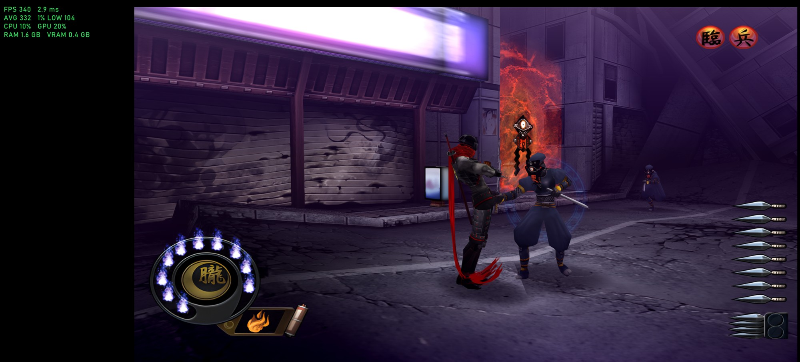
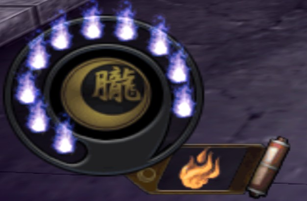
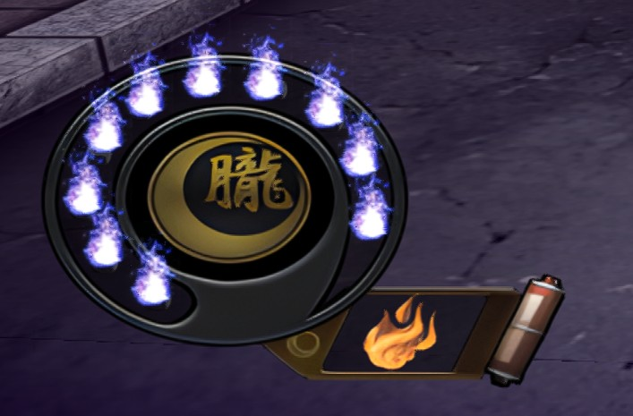
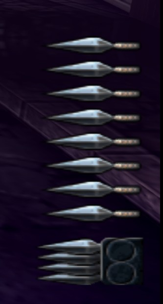
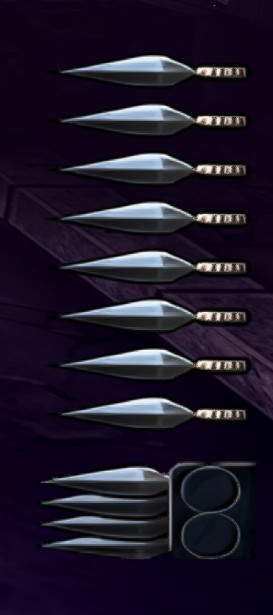
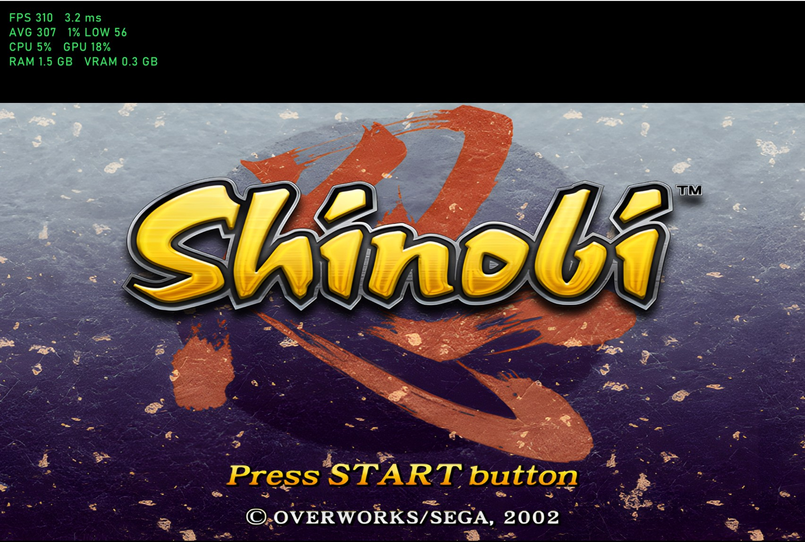
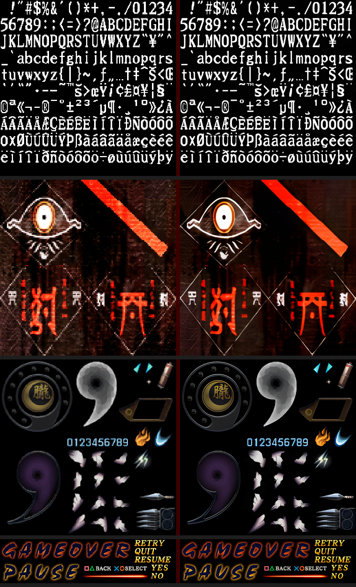
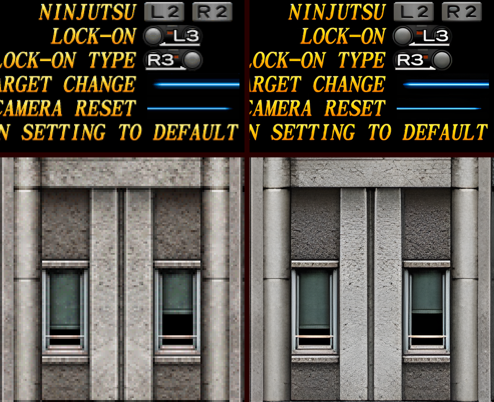

# Shinobi PS2 HD Texture Pack 1 (pre-alpha)

HD textures for **[Shinobi PS2 Recomp](https://github.com/TheRealAfsan/Shinobi-PS2-Recomp)**, the native PC recompilation of Shinobi (PlayStation 2, 2002). Also works in PCSX2.

**[Download the latest pack](https://github.com/TheRealAfsan/Shinobi-PS2-HD-Texture-Pack-1/releases/latest)** · **[Get the game recomp](https://github.com/TheRealAfsan/Shinobi-PS2-Recomp/releases/latest)**

235 of the game's textures upscaled 4x on the GPU (Real-ESRGAN), with the PS2's transparency handled properly: no bright fringes, no dark halos. There are probably 10 to 15 thousand textures in the game, so this pack grows with every update.

 Stage 1 with the HD HUD (Shinobi PS2 Recomp, 340 FPS with frame generation).

<table><tr><td width="50%" align="center"> Original HUD</td><td width="50%" align="center"> HD Texture Pack 1</td></tr>
<tr><td width="50%" align="center"> Original kunai counter</td><td width="50%" align="center"> HD Texture Pack 1</td></tr></table>

 The title screen with HD Texture Pack 1.

  The textures themselves: original on the left, HD on the right.

## What's in v1
- **The whole HUD:** health, magic, kunai, the TATE counter, the gauges, the magic flames and kanji
- **The menus:** title screen, main menu, Options and Button Config (with sharp button icons), Extra menu, stage clear and results, pause, game over, and the game's font
- **Stage title cards**, stage select pictures, the Shinobi logo and the start-up screens
- **Stage 1:** buildings, streets, walls and effects

## Installing (Shinobi PS2 Recomp)
1. Download `Shinobi-HD-Texture-Pack-v1.zip` from [Releases](https://github.com/TheRealAfsan/Shinobi-PS2-HD-Texture-Pack-1/releases/latest).
2. Unzip it into your Shinobi PS2 Recomp folder (the one with `Shinobi Launcher.exe`). The files go into `textures\SLUS-20459\replacements\`. Updating from an older pack? Just unzip over it.
3. In the launcher's Mod Menu, make sure **HD texture packs** is on (it is by default).
4. Start the game. Press **Shift+F5** in game to switch HD textures off and on and compare.

## Installing (PCSX2)
Put the `.png` files from `textures/SLUS-20459/replacements/` into PCSX2's `textures/SLUS-20459/replacements/` folder and turn on **Load Textures** in PCSX2's graphics settings (Shinobi USA, SLUS-20459).

## How it's made
1. The game saves every texture it uses (Mod Menu > *Save textures (pack makers)*).
2. [`ps2_upscale.py`](https://github.com/TheRealAfsan/Shinobi-PS2-Recomp/blob/main/scripts/ps2_upscale.py) upscales them 4x with Real-ESRGAN on the GPU. PS2 alpha runs 0 to 128, so it's doubled for the model and halved after; colours are spread into see-through pixels first so no halos appear; tiny textures are padded; and every result is checked against its original (a plain resize is used where the model would change a texture too much).
3. Movie frames are left out: each is shown once, so a replacement would never be used.

Upscaling the original textures is fine; please don't replace them with AI-generated art.

## Notes
These are 4x upscales of the original textures of Shinobi (© SEGA). You need your own copy of Shinobi (USA) to use them. Fan project, not affiliated with SEGA or Sony.
